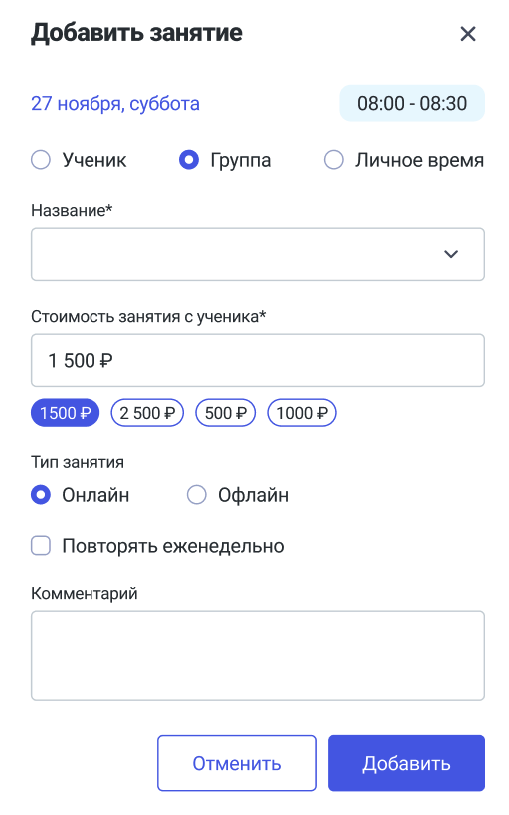

Сокращено количество экранов при создании урока с новым и текущим учеником/группой.

Пользователь нажимает "Создать занятие" из расписания или верхнего меню, появляется выбор добавить: ученика, группу, личное время. По умолчанию выбран Ученик.

{width=292px height=40px}

Модальное окно для создания занятия с Учеником выглядит так:

{width=296px height=484px}

Если же пользователь выбрал создание личного времени, то отображение будет таким:

{width=310px height=266px}

Когда пользователь выбрал создание занятия с Группой, то он увидит следующее:

{width=509px height=815px}

Также можно создать занятие из карточки конкретного ученика/группы. Тогда не надо будет выбирать, для кого именно это занятие создается, это будет определено автоматически.

11\.11.2026
