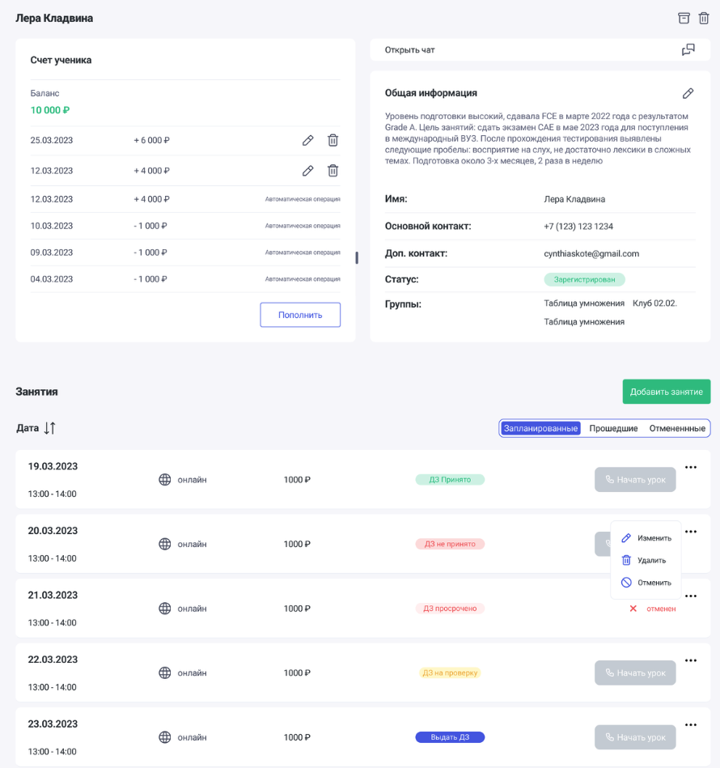

Доработано отображение карточки ученика.

{width=890px height=949px}

Реалихованы новые иконки для

- Удалить
- Перенести в Архив
- Чат
- Редактировать

Кнопки «Удалить» и «Перенести в Архив» переехали в верхний правый угол.

Под Заголовком выводится комментарий про ученика (комментарий заполняется при редактировании/добавлении ученика).

Появилось поле «Дополнительный контакт».

Отображаются все группы, в которых состоит ученик.

В виджете с занятиями появляются табы, с переключением на:

- Запланированные
- Прошедшие
- Отмененные

Отображение статусов по домашнему заданию.

Отметка зарегистрирован/не зарегистрирован ученик.

12\.11.2026
