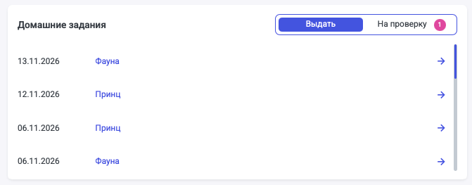

Доработан виджет «Домашние задания».

В виджете есть 2 таба Выдать/На проверку.

По умолчанию включён таб «Выдать». При этом, если у пользователя вкладка «Выдать» пустая, а в «На проверку» есть ДЗ, то по умолчанию включён таб На проверку.

{width=671px height=263px}

В таб «Выдать» не попадают отменённые занятия и занятия в архиве.

В табе «Выдать» отображаются занятия со следующей информацией:

- Дата занятия
- ФИ студента
- Кликабельная стрелка и имя ведут на расширенную карточку занятия, из которой назначаются ДЗ
- Важно, что сюда попадают занятия без ДЗ

В табе «На проверку» отображаются:

- Дата занятия
- ФИ студента
- Кликабельная стрелка и имя ведут на карточку домашнего задания
- Все занятия, у которых есть ДЗ со статусом «На проверке»
- Если у ДЗ поменялся статус, то оно перестаёт отображаться в виджете (после обновления страницы)
- Счётчик показывает фактическое количество ДЗ в статусе «На проверке» и обновляется при обновлении страницы

09\.11.2026
